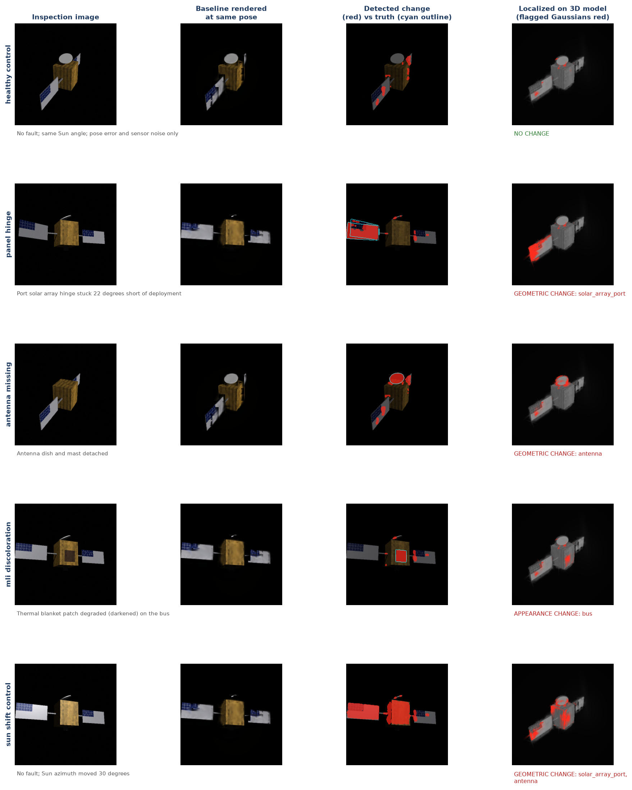

# Project Larissa: change-detection demo

A small, self-contained demonstration of the core idea behind Project Larissa:
**detect mechanical faults on a spacecraft by comparing new camera images
against a 3D Gaussian Splatting (3DGS) model of the spacecraft in a known-good
state.**

It is a proof of concept on a synthetic satellite, not the full research system.



## What the demo does

1. **Builds a test spacecraft.** A procedural satellite (bus with gold thermal
   blanket and a radiator, two solar arrays, an antenna, a thruster) is
   ray-traced under hard directional sunlight with shadows and specular
   glints. Every pixel carries a component label, which gives exact ground
   truth.
2. **Builds the baseline.** A 3DGS model is trained from 96 views of the healthy
   satellite. Each Gaussian inherits the component label of the surface it was
   initialized from, so the baseline is *labelled by component*.
3. **Calibrates its alarm levels on healthy data.** Twelve held-out views of the
   healthy satellite, with the same camera pose error and sensor noise as the
   inspections, set (a) the per-pixel change threshold and (b) for each
   component, how much flagging counts as a real change.
4. **Inspects.** Eight fixed "station" cameras, at poses never used for
   training, image the satellite in five scenarios (below). Every inspection
   image has sensor noise, an exposure jitter and a small camera pose error.
5. **Detects and localizes.** The baseline is rendered at each camera's nominal
   pose and compared with the new image. The comparison tolerates
   misregistration of up to 2 pixels, so small pose errors along the sharp
   silhouette against black space do not register as change. Each Gaussian
   then receives a vote from every camera that sees it, and is flagged only if
   most of those cameras see a change. Flagged Gaussians are counted per
   component.
6. **Classifies.** For each changed component, the system samples what every
   camera now sees where that component's flagged Gaussians project:
   - **appearance change** (discoloration, contamination): the surface is still
     there, so the cameras agree on one new colour;
   - **geometric change, vanished:** the cameras see black space where a sunlit
     surface used to be;
   - **geometric change, moved or deformed:** the cameras see whatever is now
     behind, so they disagree.

## Scenarios

| Scenario | What changed | Expected verdict |
|---|---|---|
| `healthy_control` | Nothing; pose error and sensor noise only | No change |
| `panel_hinge` | Port solar array hinge stuck 22° short of deployment | Geometric |
| `antenna_missing` | Antenna dish and mast detached | Geometric |
| `mli_discoloration` | Thermal blanket patch on the bus darkened | Appearance |
| `sun_shift_control` | Nothing; Sun azimuth moved 30° | No fault (an "illumination" notice would be acceptable) |

## Results

Single end-to-end run of `run_demo.py` (default settings, training from scratch)
on one Tesla P40 in `joshi.hpcc.uh.edu`, at commit `4e61b23`. Full output:
[`results/summary.md`](results/summary.md), [`results/summary.json`](results/summary.json),
[`results/log.txt`](results/log.txt).

**All 5 scenarios gave the expected verdict.** The three faults were detected,
attributed to the right component and given the right type; the healthy control
raised no alarm; the Sun-shift control raised no fault, only an illumination
notice.

| Scenario | Verdict | Flagged Gaussians on the changed part | Pixel recall | Pixel IoU |
|---|---|---|---|---|
| Healthy control | No change | none above alarm level | | |
| Panel hinge | Geometric: port solar array | 8114 / 8977 (90%) | 0.74 | 0.43 |
| Antenna missing | Geometric: antenna | 1956 / 1956 (100%) | 0.95 | 0.54 |
| Blanket discoloration | Appearance: bus | 2182 / 19943 (11%; the patch is about 5% of the bus surface, alarm level 2%) | 1.00 | 0.67 |
| Sun shift (no fault) | Illumination notice: bus, port array, antenna (all appearance) | (no fault reported) | | |

**Baseline.** 43,929 Gaussians, held-out PSNR 39.3 dB, trained in 15 minutes.

**Speed.** Once the baseline exists, detection over 8 cameras (render, compare,
vote, report) takes **0.52 s** on the P40; with classification a complete pass
takes at most 1.3 s.

**How to read the figure.** The third column shows pixel-level changes
*before* voting; the fourth shows the Gaussians that survive voting on a 3D
overview. A small cluster on the antenna dish is flagged in every scenario,
including the healthy control (253 of 1,956 antenna Gaussians): the baseline
renders the thin, tilted dish slightly differently from the ray-tracer.
Calibration on healthy views absorbs this by raising the antenna's alarm level
to 22%, which also makes the antenna the least sensitive component.

**The illumination control.** Moving the Sun 30° moves every shadow and glint,
and 45% of the bus, 8% of the port array and 75% of the antenna are flagged.
The cameras still agree on a single new colour for each Gaussian, so all three
are classified as appearance changes, and because three parts change at once
the pass is reported as a likely illumination change, not a fault. This is
acceptable here, but it means a real appearance fault (such as the blanket
discoloration) occurring together with a change in Sun angle would be hidden in
that notice. A Sun-aware baseline, or comparison only against captures at
matching Sun geometry, remains the key next step.

**A bug found and fixed.** An earlier version of the rasterizer kept at most
768 Gaussians per 16 x 16 pixel tile. Crowded tiles hold up to about 9,800,
so every render (training and detection) was silently truncated. With that
bug the baseline reached only 32.5 dB, the threshold had to be twice as high,
and the Sun-shift control was misclassified as a geometric fault (4/5 correct).
The bug was found while preparing paper figures and fixed in commit `4e61b23`;
the renderer now matches a brute-force reference to within 4e-7. The detection
rules were not changed after the fix. The git history keeps the earlier results.

## Dataset and notebook

- **[`data/larissa_synth_v1`](data/larissa_synth_v1)**: Larissa-Synth v1, every
  image, depth map, component label, camera pose and ground-truth change mask
  used in the results above, plus the trained baseline (about 38 MB). See its
  [README](data/larissa_synth_v1/README.md).
- **[`notebooks/larissa_walkthrough.ipynb`](notebooks/larissa_walkthrough.ipynb)**:
  loads the dataset and baseline, calibrates on the healthy held-out views, runs
  all five inspection scenarios and checks the verdicts against
  `results/summary.json`. Executed on a Tesla P40; it reproduces the original
  run exactly (same threshold, same flagged-Gaussian counts) in a few seconds.

## Running it

```bash
git clone https://github.com/RaunakDune/larissa-nerf-deploy.git
cd larissa-nerf-deploy
bash run_demo.sh 0            # GPU index; creates ./venv on first use
# or, without a GPU, a small smoke test:
pip install -r requirements.txt && python run_demo.py --device cpu --quick
```

Expect about 16 minutes on a Tesla P40, almost all of it baseline training. To
re-run only the detection on a saved baseline:
`python run_demo.py --load-baseline results/baseline_gaussians.pt --out results_rerun`.

Outputs go to `results/`: `summary.md`, `summary.json`, `scenarios.png`,
`training_views.png`, `log.txt` and the trained baseline (`baseline_gaussians.pt`,
not committed).

## Code layout

| File | Purpose |
|---|---|
| `larissa/scene.py` | Procedural satellite, fault variants, GPU ray-caster with shadows and procedural textures, camera rigs |
| `larissa/gaussians.py` | 3D Gaussian Splatting: model, tile-based differentiable rasterizer in plain PyTorch, training |
| `larissa/detect.py` | Calibration on healthy views, shift-tolerant render-and-compare, multi-view voting, per-component report, geometric versus appearance test |
| `larissa/dataset.py` | Loader for the released dataset |
| `tools/export_dataset.py` | Regenerates the dataset (replays the random sequence of `run_demo.py`) |
| `tools/classifier_check.py` | Re-runs detection and classification on all scenarios using a saved baseline (minutes, not the full training time) |
| `larissa/report.py` | Figures and the markdown summary |
| `run_demo.py` | End-to-end script |

The rasterizer is written with ordinary PyTorch operations, without custom
CUDA kernels. That makes it portable (it runs on the Tesla P40 cards in
`joshi.hpcc.uh.edu`, which recent compiled 3DGS libraries no longer target)
but slower than the reference implementation. Swapping in a
compiled rasterizer such as `gsplat` is the obvious first speed-up.

## Limitations

These are deliberate simplifications for a demo; each is a work item for the
funded project.

- **Synthetic data.** The spacecraft, lighting and faults are simulated. Real
  imagery (for example the open Astrobee ISS datasets) is the next step.
- **Known camera poses.** Cameras are assumed calibrated, with a small simulated
  error. Pose estimation from images (PnP against the baseline) is not
  implemented.
- **Initialization from depth.** The baseline is seeded from rendered depth,
  standing in for a structure-from-motion point cloud.
- **Fixed illumination model.** The baseline has no notion of Sun angle. The
  Sun-shift control is handled only by a heuristic (three or more parts with
  appearance changes at once is reported as illumination), which would mask a
  real appearance fault under a new Sun angle. A Sun-aware relightable baseline
  is the planned fix.
- **Simple detector.** Render-and-compare with voting, not a reimplementation of
  published methods such as MV3DCD or GS-Diff.
- **Rules tuned on the scenarios they are tested on.** The detector went
  through several iterations against these same five scenarios (git history
  shows each change). The pixel and component thresholds are calibrated on
  healthy data, but the voting, classification thresholds and component alarm
  offset were chosen by hand while looking at these results. Independent fault
  scenarios are needed before any accuracy claim.
